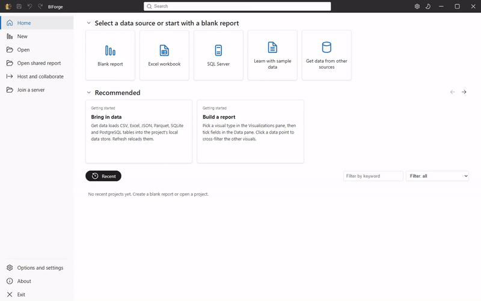
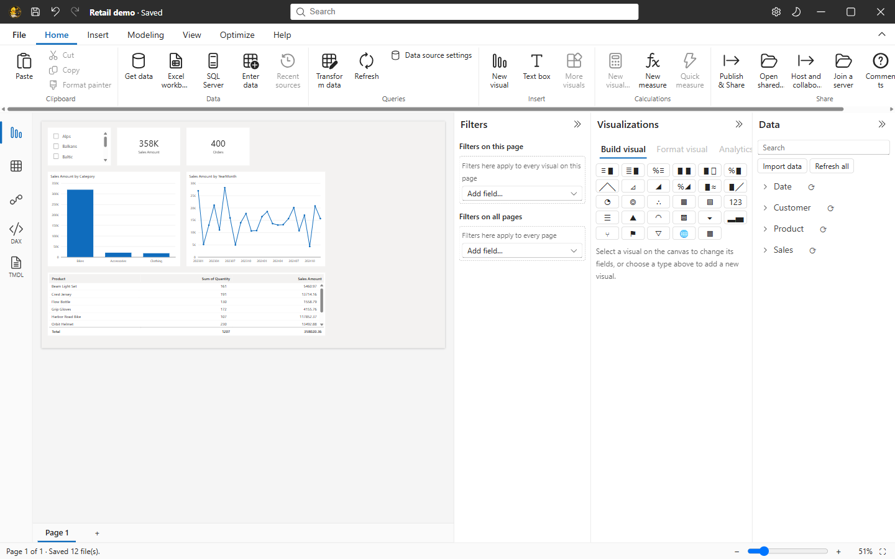
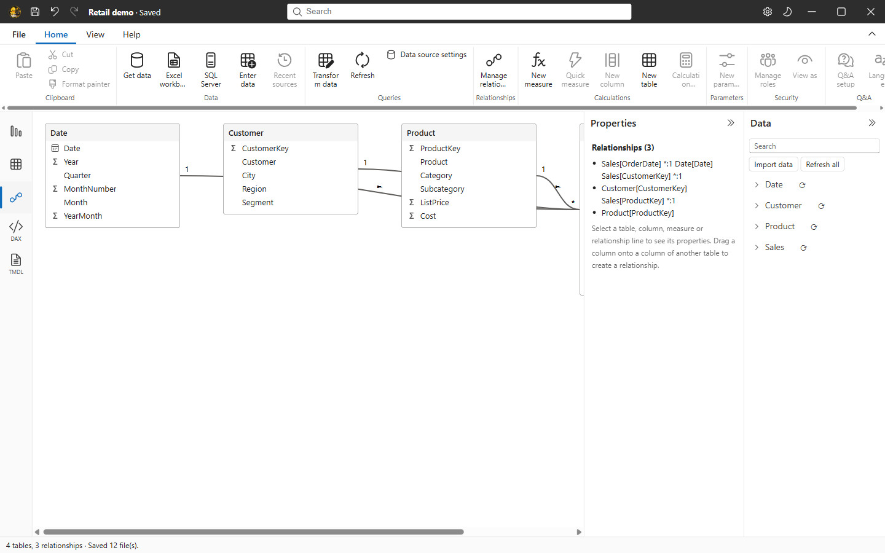
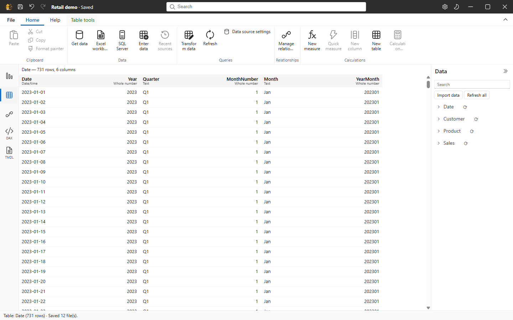
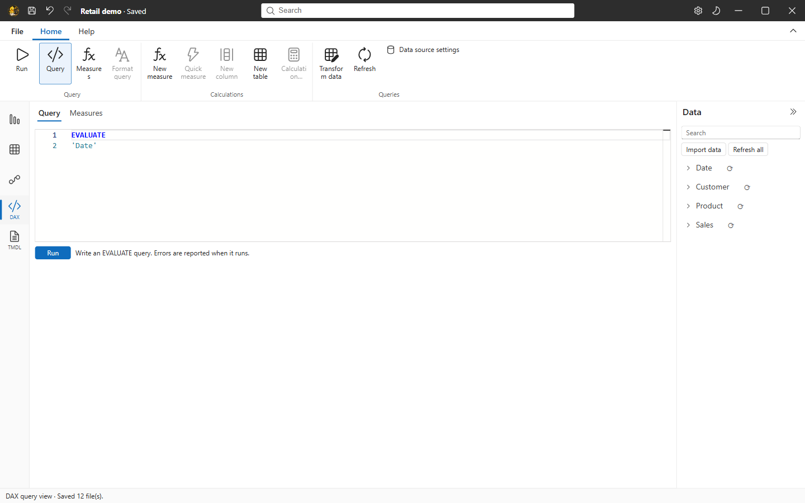
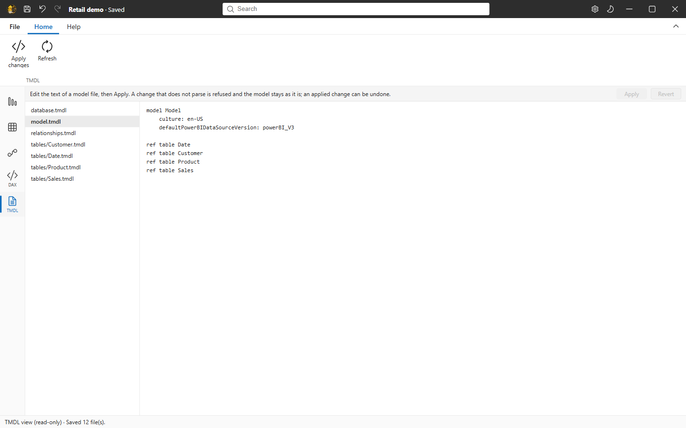
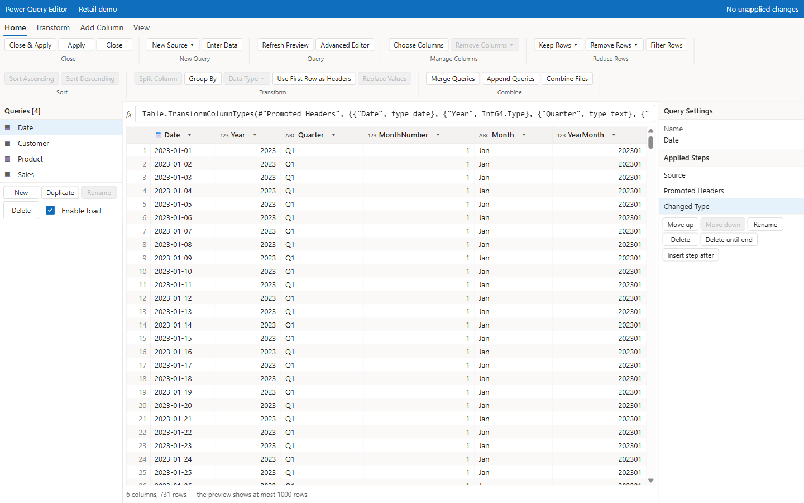

<h1 align="center">BIForge</h1>

<b>Build data models and reports on your own PC. Share them for free.</b>

<a href="docs/media/demo.mp4">Watch the demo video</a>

  
  
  

<a href="https://github.com/moelsaka01/BIForge/releases/latest">Download</a> &middot; <a href="docs/COVERAGE.md">What works</a> &middot; <a href="docs/ONLINE_GUIDE.md">Sharing guide</a> &middot; <a href="#build-from-source">Build from source</a>

BIForge is an open-source Windows app for business intelligence. Import data, shape it with Power Query steps, model it, write DAX measures and build interactive reports, all on your own computer, with an interface that feels familiar if you have used Power BI Desktop. Pick the Classic or the Modern layout; both run on the same engine and the same project.

Everything that needs a cloud account is left out. Everything you need to share a report is built in, and it is free.

> **Status: early software (v0.1.0).** Parts work and are tested; many do not exist yet. [docs/COVERAGE.md](docs/COVERAGE.md) lists every feature as Not started, Partial or Done-tested, and a feature counts as done only when an automated test passes.

## See It, Then Build It: Reports in Minutes

Start from the sample project or your own files, then move between the views with one click.

| View | Preview |
| --- | --- |
| **Start screen** Open a project, start blank, or learn with sample data. |  |
| **Report** Slicers, cards, charts and tables that filter each other. |  |
| **Model** Tables and relationships on one canvas, with a properties pane. |  |
| **Table** Look at the data behind every column. |  |
| **DAX query** Write measures and queries in an editor that knows your model. |  |
| **TMDL** Read and edit the model as plain text. |  |
| **Power Query** Applied steps, a formula bar and a live preview. |  |

Click any preview to see it at full size. More previews are coming for sharing, co-editing and scheduled refresh.

## Why BIForge Goes Further: Free, Open and Shareable

BIForge does not have every feature of Power BI Desktop, and the numbers below say so. Where it goes further is in what you do not have to pay for or sign up to.

| Feature | Why it matters |
| --- | --- |
| **Free and open source** Apache-2.0, no account, no license per viewer. | You can use, read, change and ship it, at work or at home. |
| **Sharing that costs nothing** Folders, GitHub Pages, your own Google Drive, OneDrive or Dropbox, direct connections between two PCs, or a server you host. | Publish and share without a paid workspace. Row-level security works on the server. |
| **Co-editing and comments** Edit a report together over a direct session or your server, with comments and @mentions. | Teamwork without a subscription. Tested with two real app windows. |
| **Scheduled refresh you control** Run it on a server or on this PC, with history, retries and a label that says where it ran. | No gateway to install or pay for. |
| **Projects that work with Git** A folder of text files (PBIP, TMDL and PBIR), with a command line for refresh and release checks. | Review changes, branch, merge and script them. |
| **Open both ways** Reads and writes PBIP/TMDL projects. | Your work is not locked in. |
| **Checked releases** Signed update files, signed hash lists and build attestations. | You can verify what you install. |
| **Local engine** DuckDB with its own DAX and M engines, checked against recorded Power BI Desktop results (315 of 316 recorded DAX cases match; the one difference is listed). | Fast on your PC, with the semantics checked against the real thing. |

BIForge is built from original code, tested in its own repository, and honest about the gaps: [913 of 3008](docs/COVERAGE.md) inventoried features are done and tested, 343 are partial. Microsoft cloud features (sign-in, the Power BI service, OneLake, Fabric, Copilot) are left out on purpose.

## Install

Download **BIForge_0.1.0_x64-setup.exe** (installs for the current user, no administrator rights) or **BIForge_0.1.0_x64_en-US.msi** (all users) from the [latest release](https://github.com/moelsaka01/BIForge/releases/latest). Or: `winget install moelsaka01.BIForge` once the package is accepted (see docs/SIGNING.md). The server (`biforge-server.exe`) and the command line (`biforge-cli.exe`) are optional components of both installers (setup: answer Yes at the end or run `/S /TOOLS=1`; MSI: `msiexec /i BIForge.msi ADDLOCAL=ALL`) and are also separate downloads. BIForge looks for newer versions when it starts and verifies them with its update key before installing (About > switch off).

### Windows warns about the download (SmartScreen, Smart App Control)

The installers are **not code-signed yet**; a free certificate for open-source projects (SignPath Foundation) is being applied for, see [docs/SIGNING.md](docs/SIGNING.md) and the [code signing policy](docs/CODE_SIGNING_POLICY.md). Until then:

- **SmartScreen** ("Windows protected your PC"): choose *More info*, then *Run anyway*.
- **Smart App Control** (Windows 11, *Enforcement* mode) blocks unsigned programs without a *Run anyway* button. Turn it off in Settings > Privacy & security > Windows Security > App & browser control > Smart App Control (Windows cannot turn it back on without a reset), or wait for the signed release. If you are unsure, do not turn it off.
- Check the download: every release has `SHA256SUMS` and `SHA256SUMS.sig`; `biforge-cli verify-release --public-key <contents of docs/release-public-key.txt> --dir <folder>` checks the signature and every hash, and `gh attestation verify <file> --repo moelsaka01/BIForge` checks GitHub's build attestation.

## Tech stack

Tauri 2 (Windows) · React + TypeScript (Vite) · Fluent UI React v9 · Monaco · Apache ECharts · Rust core · DuckDB · Apache Arrow.

## Architecture overview

See [docs/ARCHITECTURE.md](docs/ARCHITECTURE.md). In short: `app/` (UI shells + shared `core/` command registry and state) talks via Tauri commands to Rust crates `engine`, `dax`, `m`, `model`. Data returns to the UI as Arrow.

## Build from source

Prerequisites: Rust (stable, MSVC target), Visual Studio Build Tools (C++), Node.js 22+, WebView2 runtime. Then: `cd app && npm install && npx tauri dev` to launch; `cargo test --workspace` and `cd app && npm test` to test.

## Roadmap

| Day | Goal |
| --- | --- |
| 1 | Toolchain, workspace scaffold, blank window, CI green, DuckDB + Arrow smoke path |
| 2 | Import (CSV/Excel), model store, project folder format, Classic shell skeleton |
| 3 | DAX parser + core evaluator with conformance tests, basic visuals |
| 4 | M subset folding, TMDL import/export, Modern shell, packaging, honest coverage report |

The 4-day plan is aggressive; anything not finished will be marked as such in the UI and docs.

## Contributing

Open an issue before large changes. Every feature needs an automated test before it is marked done. Do not contribute material derived from Microsoft binaries, decompiled output, or extracted assets. See [CLAUDE.md](CLAUDE.md) for the project rules.

## License

Apache-2.0. See [LICENSE](LICENSE).

## Disclaimer

BIForge is an independent project. It is not affiliated with, endorsed by, or sponsored by Microsoft. It does not include Microsoft code or assets. "Power BI", "DAX", "Power Query" and related names are trademarks of Microsoft and are used only descriptively for compatibility.
